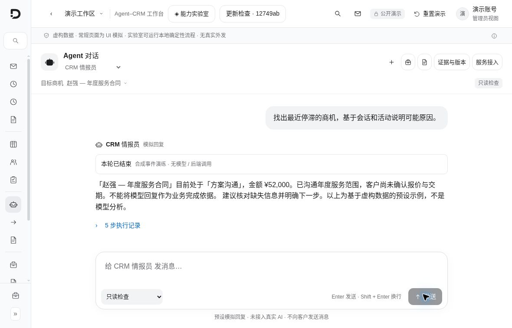
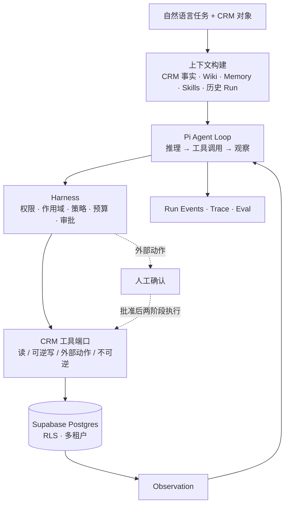
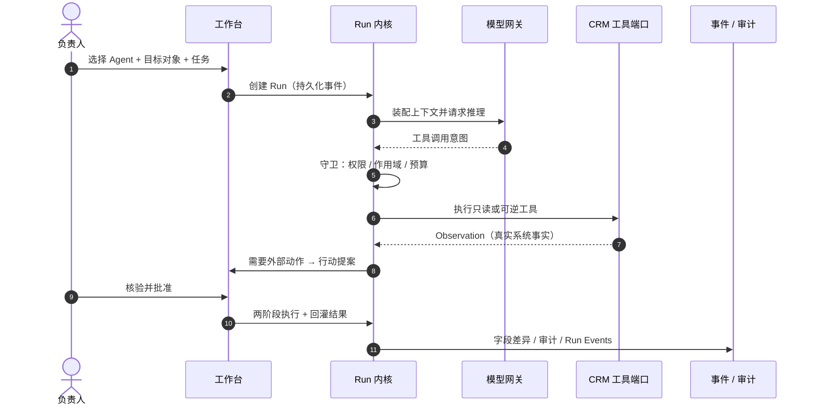
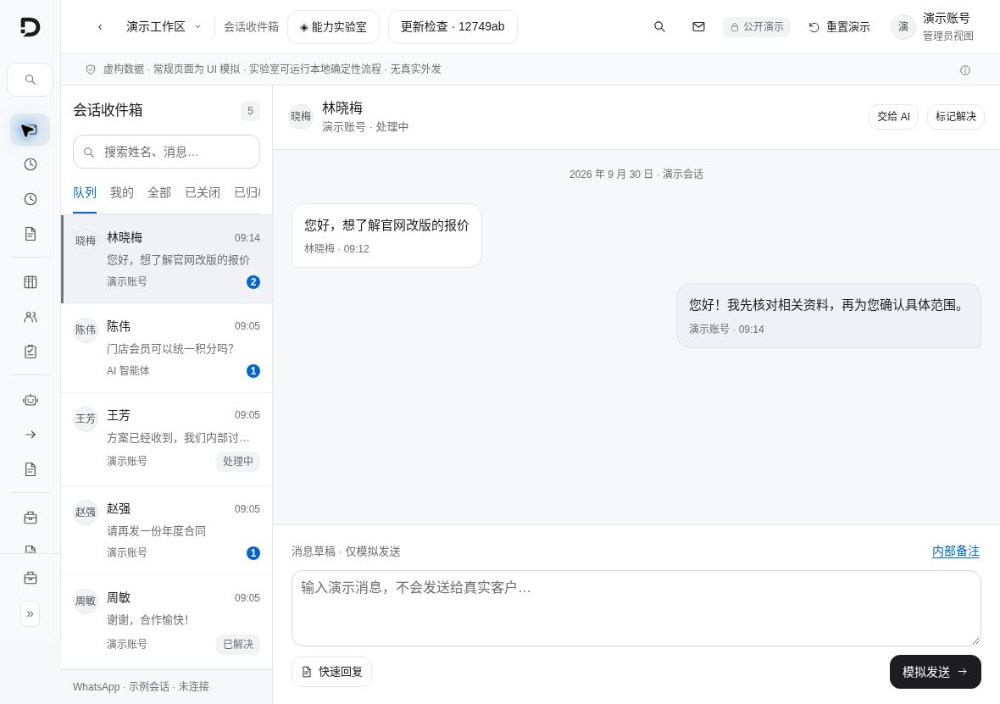
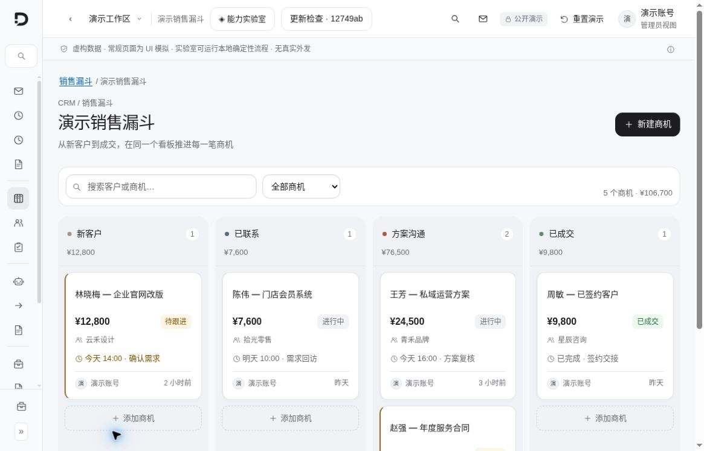
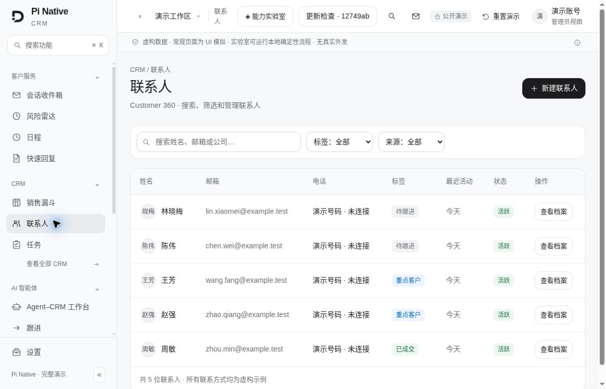
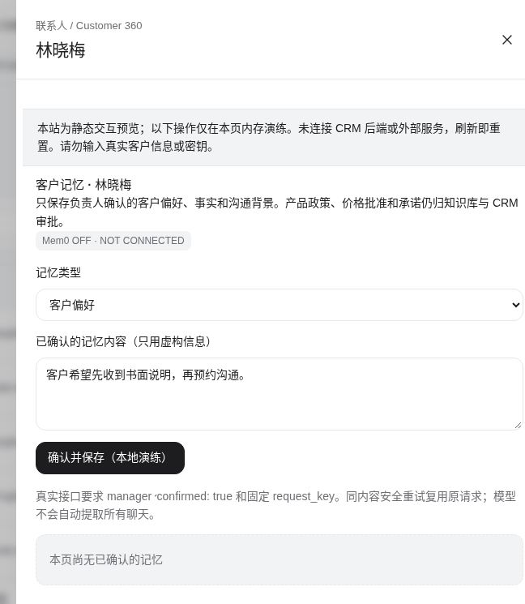
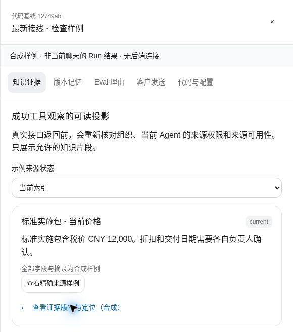
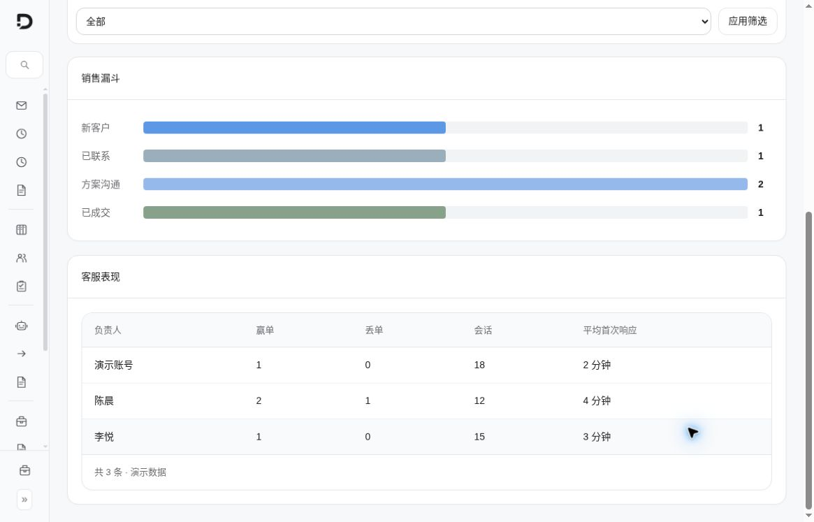
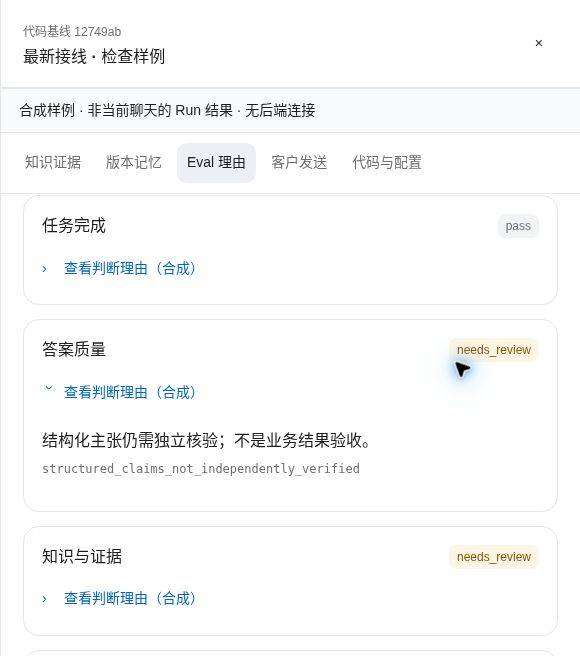

<div align="center">

# Pi Native CRM

**Agent 原生的开源 CRM —— 让 AI 在真实客户、商机与会话上干活，每一步都留痕。**

[](https://nextjs.org)
[](https://react.dev)
[](https://www.typescriptlang.org)
[](https://supabase.com)
[](https://tailwindcss.com)
[](LICENSE)
[](#自托管)
[](.nvmrc)

[30 秒演示](#30-秒零依赖演示) · [核心功能](#核心功能) · [架构](#架构) · [快速开始](#快速开始) · [安全与合规](#安全与合规)



</div>

> **English** — Pi Native CRM is a self-hosted, multi-tenant, AI-native CRM. Agents work on your real customers, opportunities and conversations: they read context, call guarded tools under policy, scope and budget, ask a human before anything irreversible, and leave an auditable trace behind every change.

---

## 这是什么

Pi Native CRM 是一个以 CRM 为状态空间的 Agent 工作台。

联系人、会话、商机、跟进任务、知识库与客户记忆共同构成 Agent 的工作环境，自然语言目标就是执行入口。它关心的不是"生成一段漂亮的回复"，而是完成一次完整的业务动作：

**理解上下文 → 找到证据 → 拆解任务 → 调用工具 → 观察结果 → 决定下一步。**

打开工作台，选一个内置 Agent、一个目标对象，写下一句任务，一次 Run 就开始了。执行过程、工具调用、审批、CRM 状态变化与评测，全部围绕同一个 Run 展开，并且可以回放。

三条设计主张：

| 主张 | 落地方式 |
| --- | --- |
| **CRM 是事实源** | 业务事实只存在于 Postgres；Run、事件与检查点保存执行状态。模型负责推理，不持有真相。 |
| **执行必须受控** | 所有读写经过工具端口，权限、组织作用域、目标范围、预算与人工审批贯穿每一次调用。 |
| **结果必须可核验** | 字段差异、审计记录、证据引用、评测分数与终止原因随 Run 保存，刷新后仍能还原当时发生了什么。 |

---

## 核心功能

### Agent 工作台

- 以**任务 + CRM 对象**为入口，区分只读调查与行动两种模式。
- 在同一条时间线上查看上下文装配、模型决策、工具调用、Observation 与 CRM 状态变化。
- 模型绑定、Token 用量、工具次数、预算与终止原因一览无余。
- 基于持久化事件与 SSE 续读，刷新页面后还能接着看执行过程。

### 客户 360 与会话收件箱

- 联系人画像、标签、来源、最近活动与完整时间线；风险雷达提示流失与异常。
- 收件箱按「队列 / 我的 / 已关闭」组织会话，支持交给 AI、标记解决、内部备注与快速回复。
- 渠道层抽象 WhatsApp（WAHA）、飞书内部协作与语音（SIP）接入，消息进入统一审计链路。

### 销售漏斗与任务

- 看板内拖动商机，阶段金额与数量实时汇总；停滞商机自动浮出。
- 跟进任务、日程预约、客户拜访与内部协作任务统一收敛到工作台。
- 商机 Mission 保存目标、验收条件、截止时间与跨运行进度。

### 知识、记忆与证据

- 本地 RAG 与 WeKnora Wiki 双通道检索，为回答提供知识来源、页面版本与原文引用。
- 客户记忆走两阶段状态机：会话收口或任务完成后生成候选 → 负责人确认、改写或驳回 → 到期、锁定、复核与替换。
- 每条知识证据绑定版本哈希与原文片段；命中不到权威页面时明确返回"资料缺失"，而不是编造承诺。

### 评测与可观测

- 围绕任务结果、证据、工具可靠性、策略遵守与记忆覆盖进行评测。
- 确定性检查 + 真实模型语义评审 + 回归样例，评分依据可回看。
- Sentry 负责异常，Langfuse 接收模型与工具边界的 Trace、用量与 Eval 分数。

### 平台底座

- **多租户从第一天开始**：所有租户表强制 RLS，隔离下沉到数据库引擎。
- **RBAC**：`viewer` < `agent` < `manager` < `admin` 四级角色，外加跨租户的平台管理员；MFA（TOTP）由管理员按组织/平台策略开启。
- **审计**：每次成功变更落一条 append-only 审计记录，默认保留 5 年、可配置，并带执行中的到期清理。
- **LGPD**：导出、匿名化与删除请求全流程留痕，优先匿名化而非物理删除。
- **扩展**：核心在零扩展时保持完整；安装扩展不授予任何权限，启用与配置属于组织自己的决定。
- **自托管**：Docker Compose 编排 + 安装、升级、诊断、健康检查套件。

---

## 架构



| 层 | 职责 | 关键技术 |
| --- | --- | --- |
| 呈现层 | 工作台、看板、收件箱、设置 | Next.js 16 App Router · React 19 · Tailwind 4 · shadcn/ui · TanStack Query |
| 边缘与服务端 | 会话校验、RBAC、限流、入参契约 | `proxy.ts` · Route Handlers · Zod · Upstash Redis |
| 事实层 | 业务数据、行级隔离、私有媒体 | Supabase Postgres · RLS helper · Storage |
| 执行层 | Agent Run、工具端口、Harness | Pi Agent Core · Model Gateway · workers |
| 异步与观测 | 事件消费、定时任务、Trace、Eval | `event_log` + worker · Sentry · Langfuse |

几个不那么显眼但很关键的决定：

- **Postgres 触发器从不发 HTTP。** 触发器只往 `event_log` 写一行，所有高延迟副作用（发信、调模型、索引、外呼）由后台 worker 轮询消费；WhatsApp 或模型超时不会拖住 CRM 主事务。
- **同仓库不等于共享信任。** 页面代码与 API 在同一个 Next.js 应用里，但业务规则、权限守卫与审计只发生在服务端 Route Handlers。
- **`organization_id` 只从可信来源取**（会话 cookie、JWT、webhook secret、path token），永远不信任请求体。

---

## 一次运行的生命周期



- **可中断**：支持暂停、恢复、取消、执行租约、重试与累计预算控制。
- **可回放**：上下文、决策、工具入参与结果、Observation 都是持久化事件，SSE 可从任意位置续读。
- **多 Agent**：主管 Agent 组织只读专职调查，父子 Run 各自保存上下文；业务写入与预算由父 Run 统一裁决。

### 工具分级

| 级别 | 典型工具 | 执行策略 |
| --- | --- | --- |
| **读取** | 查客户、检索会话、读知识库 | 循环内直接执行 |
| **可逆写入** | 改字段、调阶段、建任务 | 前置快照 + `expected_updated_at` 乐观锁，保留撤销参数 |
| **外部动作** | 给客户发 WhatsApp、对外日程 | 生成行动提案，人工批准后两阶段执行 |
| **不可逆** | 删除数据、签署类动作 | 直接阻断 |

### 内置 Agent

| Agent | 职责 |
| --- | --- |
| **CRM 情报员** | 汇总客户、历史会话、商机、知识与记忆，形成带证据的客户画像 |
| **销售运营 Agent** | 排查停滞商机、更新字段、调整阶段、安排后续跟进 |
| **客户沟通 Agent** | 结合会话与知识起草回复，核对承诺依据，提出转人工动作 |
| **CRM 主管 Agent** | 跨漏斗、任务与执行记录调查异常，组织专职 Agent 协作并汇总结果 |

内置原件保持锁定；需要定制时「复制并定制」：副本固定创建时的模型配置，原件跟随组织默认模型。

---

## 核心界面

| Agent 工作台 | 会话收件箱 |
| --- | --- |
|  |  |
| **销售漏斗** | **客户 360** |
|  |  |
| **客户记忆（负责人确认）** | **知识与证据** |
|  |  |
| **指标看板** | **Eval 理由** |
|  |  |

> 截图来自仓库自带的演示站点，全部为虚构客户与金额。

---

## 技术栈

| 领域 | 选型 |
| --- | --- |
| 框架 | Next.js 16（App Router）· React 19 · TypeScript 6（严格模式） |
| 样式与组件 | Tailwind CSS 4（CSS-first 配置）· shadcn/ui · Radix · Phosphor Icons |
| 数据与鉴权 | Supabase（Postgres · Auth · Realtime · Storage）· RLS · `@supabase/ssr` |
| 数据获取 | TanStack Query · TanStack Virtual · React Hook Form + Zod 4 |
| Agent 运行时 | Pi Agent Core / Pi AI · Model Gateway（OpenAI / Anthropic / Google 及兼容接口） |
| 异步 | `event_log` 事件表 + worker + cron · Upstash Redis |
| 观测 | Sentry（PII 清洗）· Langfuse（Trace / 用量 / Eval） |
| 渠道 | WAHA（WhatsApp NOWEB）· 飞书 · Asterisk / SIP |
| 集成 | Mem0（客户记忆）· WeKnora（组织 Wiki）· MCP（CRM 全量工具） |
| 测试与质量 | Vitest · Playwright · ESLint 9 · Prettier |

---

## 快速开始

### 30 秒零依赖演示

不需要数据库、不需要任何模型 Key，演示站点是纯静态页面：

```bash
git clone https://github.com/kbkb628/crm.git
cd crm
node scripts/serve-agent-demo.mjs
# → http://127.0.0.1:3008/#/app/ai/workbench
```

演示站包含合成 CRM 场景、脱敏的真实模型录制与本地确定性流程（「能力实验室」）。所有客户、金额、审批与任务都是虚构的；"真实模型录制"只是历史回放，不会发起新的模型请求，也不会向真实客户发送任何消息。

### 本地完整运行

准备 Node.js 22+、pnpm 9，以及一套开发用 Supabase 与 Redis。

```bash
pnpm install --frozen-lockfile

# 仅在不存在时创建，保留已有配置
test -e .env.local || cp .env.example .env.local
test -e .env || touch .env
```

按 `.env.example` 的注释填写 Supabase、Redis、应用地址与服务端加密配置，然后初始化数据库：

```bash
pnpm db:migrate                 # 或者直接应用 supabase/baseline.sql
pnpm ai:agents:ensure-builtins  # 为已有组织幂等补齐内置 Agent
```

在不同终端启动三件事：

```bash
pnpm dev        # Web 服务        http://localhost:3000
pnpm worker     # Agent 执行进程
pnpm dev:crons  # 本地辅助调度
```

打开 [Agent 工作台](http://localhost:3000/app/ai/workbench)，在组织的模型配置页绑定真实模型凭据，选择一个内置 Agent、一个 CRM 对象和一句任务即可开始。

想先看填充好的数据，可以用演示种子（仅允许 `development` + 本地 Supabase）：

```bash
pnpm demo:seed   # 需要 CRM_DEMO_MODE=true 与 CRM_DEMO_EMAIL / CRM_DEMO_PASSWORD
```

演示模式有三重判定：`NODE_ENV !== production`、`CRM_DEMO_MODE === "true"`、且 Supabase 地址解析为 `localhost` / `127.0.0.1` / `::1`。它是开发便利，不是鉴权后门——生产环境永远不会点亮演示账号。

### 自托管

```bash
# VPS 已有反向代理（Hostinger / Coolify / Dokploy …）时，两个 compose 文件都要带
docker compose -f docker-compose.prod.yml -f docker-compose.traefik.yml --env-file .env up -d app
```

漏掉第二个 `-f` 会重建容器但不带路由标签：容器 `healthy`，域名却回 `404`。

安装、升级、诊断与健康检查脚本在 [`hostgator-setup-kit/`](hostgator-setup-kit) 中。

---

## 项目结构

```text
app/                  页面与 Route Handlers（370+ 端点 / 130+ 页面）
components/           工作台、看板、收件箱等 React 组件
lib/                  agent-engine、工具与 Harness、RAG、记忆、鉴权、审计
workers/              event_log 消费者与后台任务
supabase/             迁移、RLS 策略与自托管基线（340+ 迁移）
hostgator-setup-kit/  自托管安装、升级、诊断套件
docker/               Dockerfile（app / worker / scheduler / voice）与 Caddyfile
examples/             零依赖演示站点
infra/                本地 Agent 服务与部署配置
scripts/              运维与开发命令行
assets/               文档与演示截图
```

文档与协作入口：

- [`CONTRIBUTING.md`](CONTRIBUTING.md) —— 开发流程、分支与 PR 约定
- [`SECURITY.md`](SECURITY.md) —— 漏洞报告与关注范围
- [`examples/chat-first-demo/`](examples/chat-first-demo) —— 零依赖演示站点的实现

> 本仓库是面向展示与二次分发的运行版：内部设计文档、研究记录、验证证据与测试套件未随包发布，仓库中不包含 `test` 脚本与测试配置。

---

## 常用命令

| 命令 | 用途 |
| --- | --- |
| `pnpm dev` | 启动开发服务 |
| `pnpm worker` | 启动 Agent 执行进程 |
| `pnpm dev:crons` | 启动本地辅助调度 |
| `pnpm build` / `pnpm start` | 生产构建与启动 |
| `pnpm typecheck` | TypeScript 类型检查 |
| `pnpm lint` | ESLint 检查 |
| `pnpm db:migrate` | 应用数据库迁移 |
| `pnpm demo:seed` | 写入演示数据（仅本地） |
| `pnpm ai:agents:ensure-builtins` | 幂等补齐内置 Agent |

---

## 集成

第三方服务按组织绑定与启用，凭据只在服务端保管，不写入执行事件或提交记录。

| 能力 | 适配 |
| --- | --- |
| 模型 | 组织级凭据、默认模型绑定、固定模型版本；OpenAI / Anthropic / Google 与兼容接口，自带密钥（BYOK）+ 预算 + 用量审计 |
| 客户记忆 | Mem0 适配器：检索排序、同步队列、删除与清理回执 |
| 知识与 Wiki | WeKnora 检索与来源接口，与本地 RAG、组织知识权限衔接 |
| Trace / Eval | Langfuse 项目绑定、OTLP Trace 与评测分数投递 |
| WhatsApp | WAHA 会话与消息工具，外发进入审批与审计 |
| 内部协作 | 飞书身份映射、成员绑定、消息队列与回复关联 |
| 语音 | Asterisk / SIP 接入，事件桥接与录音 |
| 外部系统 | 全量 CRM 能力经 MCP 暴露，服务端 Bearer token 以哈希存储 |

---

## 安全与合规

- **多租户**：租户表一律 `organization_id` + RLS；隔离由数据库执行，而不是靠工程师记得写 `where`。
- **鉴权**：服务端始终校验 JWT（`getUser()`），不信任未复验的会话；API Token 只存 SHA256 哈希，明文仅展示一次。
- **边界**：写操作先过 Zod 校验、再过 `requireRole()`、`organization_id` 取自可信来源，最后落审计。
- **限流**：登录、注册、找回密码、邀请接受与关键公共端点按 IP 与标识符双维度限流。
- **Webhook**：HMAC + `timingSafeEqual` 校验，secret 缺失时 fail-closed。
- **审计**：不可变（append-only）审计表，保留期可配置并带受控清理。
- **隐私**：日志与 Sentry 事件在 `beforeSend` 处清洗 PII；LGPD 导出、匿名化与删除全流程可审计。
- **演示隔离**：演示模式仅在本地回环 + 非生产环境生效，永远不会成为生产后门。

---

## 状态与后续

当前是内部研发版本，主分支持续围绕 Agent 工作台、受控工具、多 Agent 协作、商机 Mission、知识与记忆闭环以及评测体系迭代。已经跑通并留下记录的部分包括：真实模型运行、多 Agent 协作、Mem0 / WeKnora / Langfuse 联调与脱敏回放。

后续方向：

- 更多渠道适配器与更细的发送节奏控制
- 声明式扩展包的安装、升级与回滚体验
- 更完整的评测集与回归门禁
- 多语言界面

---

## 贡献

欢迎 Issue 与 Pull Request。动手之前请先读 [`CONTRIBUTING.md`](CONTRIBUTING.md)：

1. Fork 并基于 `main` 建分支；
2. 保持 `pnpm typecheck` 与 `pnpm lint` 干净；
3. 涉及数据库变更时，提供可重复应用的迁移文件；
4. 涉及界面或用户流程时，附上可视化证据；
5. 一个 PR 只做一件事，写清动机与影响面。

安全问题请勿公开提交 Issue，按 [`SECURITY.md`](SECURITY.md) 私下报告。

---

## 许可

本项目以 [MIT License](LICENSE) 发布。
